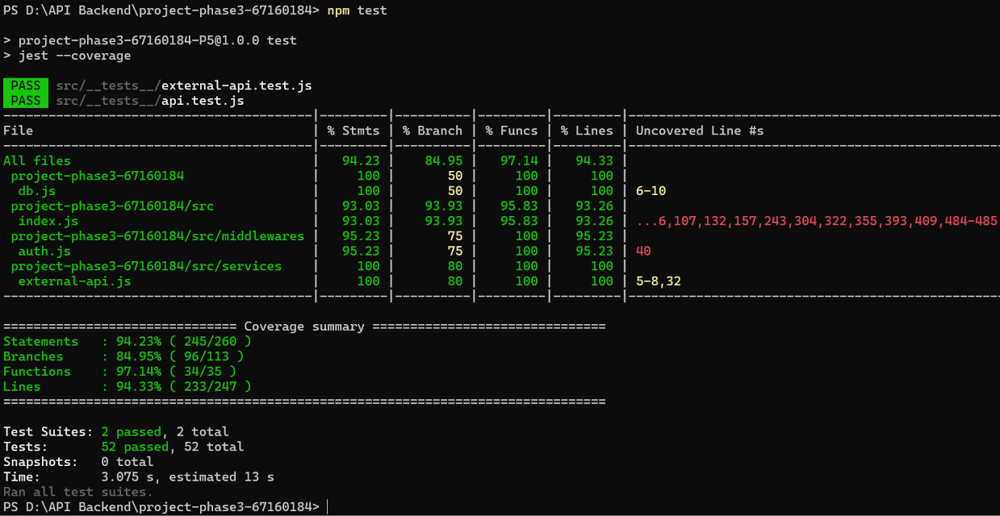

# Test Coverage Baseline — StockPro (project-phase3-67160184)

## วิธีรัน

```bash
npm install
npm test        # = jest --coverage
```

test สร้างฐานข้อมูลทดสอบแยก `product_db_test` จาก [schema.sql](schema.sql) + [seed.sql](seed.sql) ทุกครั้งก่อนรัน ([src/__tests__/setup/global-setup.js](src/__tests__/setup/global-setup.js)) จึงเริ่มจากข้อมูลเดิมเสมอและไม่แตะข้อมูล demo ใน `product_db` — ต้องเปิด MySQL ไว้ (ค่าเชื่อมต่ออ่านจาก `.env` หรือค่าเริ่มต้นใน [db.js](db.js))

## ผลการรันจริง

ผลรัน `npm test` ล่าสุด: 52 test ผ่านทั้งหมด ภาพด้านล่างแสดงผลหลังย้าย `db.js` มาอยู่ระดับบนตามโครงส่งล่าสุด



```
PASS src/__tests__/api.test.js
PASS src/__tests__/external-api.test.js
File                 | % Stmts | % Branch | % Funcs | % Lines | Uncovered Line #s
All files            |   94.23 |    84.95 |   97.14 |   94.33 |
 db.js (ระดับบน)     |     100 |       50 |     100 |     100 | 6-10
 src/index.js        |   93.03 |    93.93 |   95.83 |   93.26 | 71,96,107,132,157,243,304,322,355,393,409,484-485
 src/middlewares/auth.js | 95.23 | 75 | 100 | 95.23 | 40
 src/services/external-api.js | 100 | 80 | 100 | 100 | 5-8,32
Statements   : 94.23% ( 245/260 )
Branches     : 84.95% ( 96/113 )
Functions    : 97.14% ( 34/35 )
Lines        : 94.33% ( 233/247 )

Test Suites: 2 passed, 2 total
Tests:       52 passed, 52 total
```

## test ที่มี (52 test)

| ไฟล์ | ประเภท | ครอบคลุม |
| --- | --- | --- |
| [src/__tests__/api.test.js](src/__tests__/api.test.js) (46 test) | Integration — Supertest เรียก API จริง + MySQL จริง | การยืนยันตัวตนที่เพิ่มใน Phase 3 (login admin ได้ token, รหัสผิด/อีเมลไม่มีได้ 401 ข้อความเดียวกัน, ไม่ส่งข้อมูล 400, `/auth/me`, GET ไม่ต้อง login, POST/PATCH/DELETE ไม่มี token ได้ 401 และข้อมูลไม่เปลี่ยน, token ปลอมได้ 401, role อื่นได้ 403, เปลี่ยนรหัสผ่าน: สำเร็จแล้วรหัสใหม่ login ได้/รหัสเดิมใช้ไม่ได้, รหัสเดิมผิด 401, รหัสใหม่สั้น/ซ้ำของเดิม/ไม่ครบ 400, ไม่มี token 401) — test ที่เพิ่ม/แก้ไข/ลบทั้งหมดแนบ token ของ admin จาก `seed.sql`, `/health`, UC-01 ถึง UC-05 ของ Phase 1 ทั้งกรณีสำเร็จและผิดพลาด (404, ข้อมูลซ้ำ 500), `GET /products/:id/price` ของ Phase 2 ทั้งแปลงสำเร็จ / สกุลเงินไม่รองรับ / รูปแบบผิด / API ภายนอกล่มแล้ว fallback, การจัดการข้อมูลที่เพิ่มใน Phase 3 (แก้ชื่อ/SKU, ย้ายหมวดหมู่/ผู้จัดจำหน่าย, ตั้งผู้จัดจำหน่ายเป็น null, หมวดหมู่ที่ไม่มีอยู่ได้ 500, PATCH ว่างได้ 400, แก้ SKU ซ้ำได้ 500, ลบสินค้าแล้วอ่านกลับได้ 404, รายการหมวดหมู่/ผู้จัดจำหน่ายพร้อมจำนวนสินค้า, แก้ไขหมวดหมู่ (สินค้าเห็นชื่อใหม่) และผู้จัดจำหน่ายทุกช่อง พร้อมกรณีชื่อ/อีเมลซ้ำ 500 ไม่ส่งช่อง 400 id ไม่มี 404, ลบหมวดหมู่แล้วสินค้าถูกลบตาม (CASCADE), ลบผู้จัดจำหน่ายแล้วสินค้ายังอยู่แต่ไม่มีผู้จัดจำหน่าย (SET NULL), ลบ id ที่ไม่มีได้ 404), เส้นทางที่ไม่มีอยู่ |
| [src/__tests__/external-api.test.js](src/__tests__/external-api.test.js) (6 test) | Unit — ยิง HTTP จริงไปเซิร์ฟเวอร์จำลองบนเครื่อง | retry เมื่อ 5xx/429, ไม่ retry เมื่อ 404, ล้มครบแล้ว fallback, timeout, สกุลเงินไม่มีในผล |

บริการอัตราแลกเปลี่ยนใน test เป็นเซิร์ฟเวอร์ HTTP จริงที่เปิดบนเครื่อง (ไม่ใช่ mock ของ axios) เพื่อให้ผลคงที่ไม่ขึ้นกับอินเทอร์เน็ต — ส่วนการทดสอบกับ API ภายนอกตัวจริงทำไว้แล้วใน `failure-scenario-results.md` ของ Phase 2

## จุดที่ยังไม่มี test ครอบคลุม (ทุกไฟล์ที่ไม่ถึง 100% พร้อมเหตุผล)

| อันดับ | ไฟล์ | บรรทัดที่ไม่ครอบคลุม | เหตุผล / ความเสี่ยง |
| --- | --- | --- | --- |
| 1 | [src/index.js](src/index.js) (Statements 93.03%) | 71, 107, 132, 157, 243, 304, 322, 355, 393, 409 คือ `next(err)` ในเส้นทาง login, เปลี่ยนรหัสผ่าน, GET รายการสินค้า, GET รายชิ้น, แปลงราคา, DELETE สินค้า, GET หมวดหมู่, DELETE หมวดหมู่, GET ผู้จัดจำหน่าย และ DELETE ผู้จัดจำหน่าย | ทำงานเฉพาะเมื่อ query ฐานข้อมูลล้มเหลว (เช่น MySQL ล่มกลางทาง) ซึ่งจำลองใน test แบบใช้ฐานข้อมูลจริงได้ยาก — ความเสี่ยงต่ำ เพราะ error middleware ปลายทางถูกทดสอบแล้วผ่านกรณีข้อมูลซ้ำ (500) |
| | | 96 คือเปลี่ยนรหัสผ่านแล้วไม่พบบัญชี (404) | เกิดเฉพาะเมื่อบัญชีถูกลบจากฐานข้อมูลหลัง login ทั้งที่ token ยังไม่หมดอายุ — ระบบไม่มี API ลบบัญชี จึงไม่เกิดจากการใช้งานปกติ |
| | | 484-485 คือ `app.listen()` | ทำงานเฉพาะตอนสั่ง `npm start` — test เรียก `app` ผ่าน Supertest โดยไม่เปิดพอร์ต; ตรวจด้วยมือแล้วว่า `npm start` เปิดเซิร์ฟเวอร์ได้ |
| 2 | [src/middlewares/auth.js](src/middlewares/auth.js) (Branches 75%) | 40 คือกรณี `authorizeRole` ถูกเรียกโดยไม่มี `req.user`, และค่าสำรองของ `JWT_SECRET`/`JWT_EXPIRES_IN` | ทุก route ใช้ `authenticateToken` ก่อน `authorizeRole` เสมอ (`requireAdmin`) จึงไม่เกิดจริง เป็นการป้องกันไว้ถ้าภายหลังมีคนใช้ `authorizeRole` ลำพัง; ค่าสำรองของ secret ใช้เฉพาะเครื่องที่ไม่มี `.env` (test ตั้ง `JWT_SECRET` เอง) |
| 3 | [db.js](db.js) (Branches 50%) | 6-10 ค่าเริ่มต้นหลัง `\|\|` | ทางเลือกตอน**ไม่มี** `.env` ไม่ถูกใช้ใน test เพราะเครื่องทดสอบมี `.env` — ความเสี่ยง: ถ้าค่าเริ่มต้นผิด จะรู้ตอนติดตั้งบนเครื่องที่ไม่มี `.env` |
| 4 | [src/services/external-api.js](src/services/external-api.js) (Branches 80%) | 5-8 ค่าเริ่มต้นของ config, 32 `error.code \|\| error.message` | ค่าเริ่มต้นถูกแทนด้วยค่าที่ test ตั้งเอง และบรรทัด 32 เป็นแค่ข้อความ log กรณี error ไม่มี `code` — ไม่กระทบพฤติกรรม retry/fallback ที่ทดสอบครบแล้ว |

## หมายเหตุ

- ใบงานสัปดาห์ที่ 9 (Jest/Supertest) ฝึกบนโปรเจกต์ตัวอย่าง `student-api` ส่วน test ชุดนี้เขียนใหม่สำหรับ StockPro ใน Phase 3 ตามรูปแบบเดียวกัน
- สัปดาห์ที่ 13 เป็นงานออกแบบ Microservices (ไม่ได้แยกโค้ดจริง) จึงไม่มี test ของบริการแยก — ส่วนที่ออกแบบให้มี Retry/Timeout/Fallback (Product Service → External API) มีโค้ดจริงและ test จริงใน `external-api.test.js`
- นอกจาก test ข้างบน หน้าเว็บ (frontend) ทดสอบในเบราว์เซอร์จริง (ไม่นับใน coverage นี้ เพราะ Jest วัดเฉพาะโค้ดฝั่ง server): ก่อนเพิ่มฟีเจอร์แก้ไข/ลบใช้ Playwright ผ่าน 46/46 ขั้นตอน หลังเพิ่มฟีเจอร์ทดสอบ login/ออกจากระบบ/token หมดอายุ, โหมดดูอย่างเดียว, ช่องค้นหา และปุ่มแก้ไข/ลบสินค้า หมวดหมู่ และผู้จัดจำหน่ายในเบราว์เซอร์อีกรอบ (2026-10-25)
