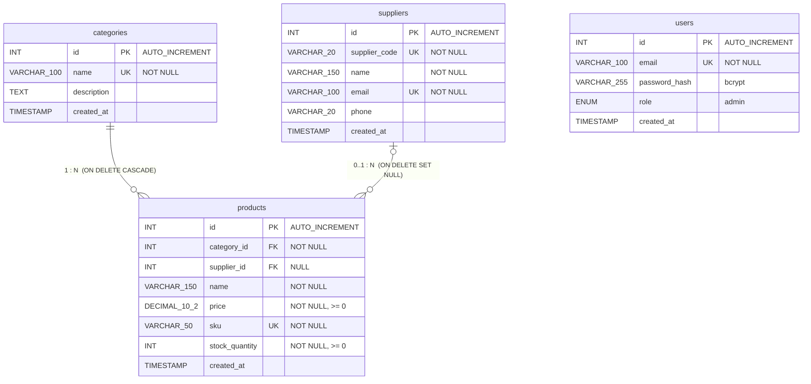

# ERD — StockPro (ฐานข้อมูล `product_db`)

ภาพสำหรับส่งงานคือ [erd.png](erd.png) — ไฟล์นี้เป็นฉบับข้อความ (Mermaid) แสดงผลเป็นแผนภาพได้ใน VS Code (`Ctrl+Shift+V`) หรือ GitHub

## ความสัมพันธ์

| จาก | ไป | ชนิด | เมื่อลบฝั่งแม่ |
|---|---|---|---|
| `categories.id` | `products.category_id` | 1 : N (สินค้าต้องมี 1 หมวดหมู่) | **CASCADE** — สินค้าในหมวดถูกลบตาม |
| `suppliers.id` | `products.supplier_id` | 0..1 : N (สินค้าไม่มีผู้จัดจำหน่ายได้) | **SET NULL** — สินค้ายังอยู่ ช่องผู้จัดจำหน่ายเป็นว่าง |

`users` ใช้เก็บบัญชีผู้ดูแลระบบสำหรับ login (JWT) ไม่มี foreign key เชื่อมกับตารางอื่น

คำอธิบาย: **PK** = Primary Key · **FK** = Foreign Key · **UK** = Unique
